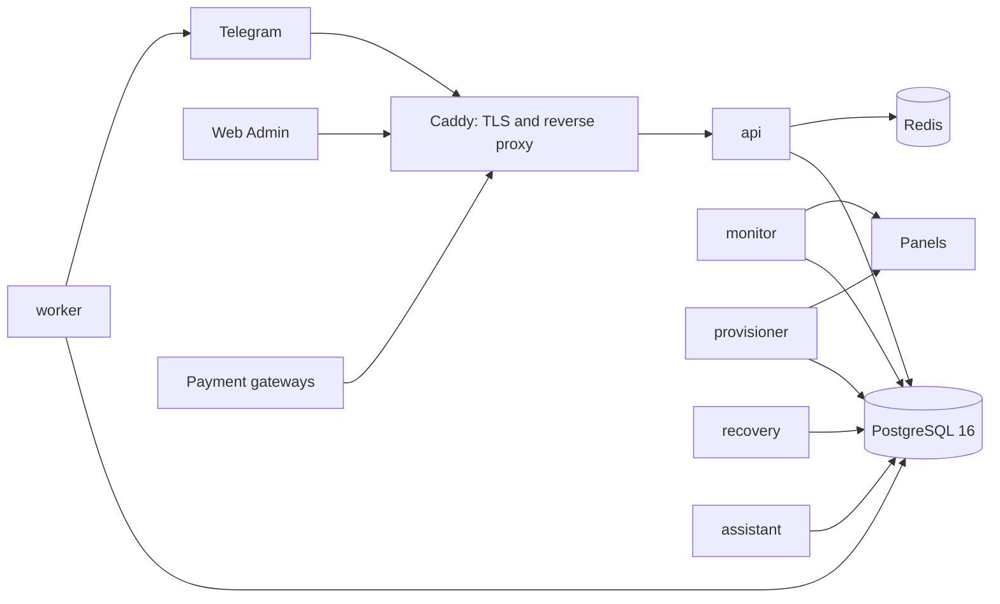

English | [فارسی](README.fa.md)

# NEXA

**A self-hosted, tenant-aware Telegram platform for selling and managing VPN and proxy services.**

[](https://github.com/Mhoseinshah1/nexa-bot/releases/latest)
[](https://github.com/Mhoseinshah1/nexa-bot/actions/workflows/ci.yml)


Customers browse, buy, renew and manage services in a Telegram bot or a Telegram
Mini App. Operators run the business from a Persian right-to-left Web Admin.
Paid orders are provisioned automatically on the operator's own panels. Nexa is
a from-scratch replacement for MirzaBot; the research behind it is in
`docs/research/` and the decisions taken from it are in `docs/adr/`.

## Screenshots

Screenshots will be added with the final release.

## Features

Everything below is in the code on `main`. Items that are built but not yet
accepted against the real provider, or off by default, are marked **Beta**.

### Selling

- Catalogue, orders, renewals, extra traffic or time, trials, discounts, gift
  cards and cashback.
- Pricing rules, resellers with their own credit, and a referral programme.
- Support tickets, broadcasts and customer messaging.

### Payments

- Gateways: TonPays (**Beta**: not yet accepted against the real provider),
  TonPays (Telegram), TetraPay, NOWPayments, CentralPay, Rialit and Telegram
  Stars, plus card-to-card receipts reviewed by an operator.
- A gateway callback only prompts a check. The provider's own inquiry decides
  whether money is credited.
- Balances are derived from an append-only ledger. Money is `bigint` minor units
  with an explicit currency, never a float.
- Refunds, and a gateway health view.

### Panels

- Marzban, 3x-ui (MHSanaei) and RickPanel adapters.
- A custom panel protocol (Nexa's own signed JSON-over-HTTPS bridge): **Beta**,
  off by default, not yet accepted against a real bridge.
- Encrypted panel credentials, a background health monitor, capacity limits and
  automatic provisioning of paid orders. An order that cannot be delivered is
  refunded, not queued.

### Operations

- A Telegram forum group with one topic per concern (payments, panels, errors,
  backups, security, ...) that receives operational events.
- Scheduled, encrypted database backups, restore-tested before delivery to
  Telegram, and a Web Admin recovery lane that restores one.
- `botctl`: status, backup, update by image digest, rollback, log following.

### Customer surfaces

- A Telegram bot. All customer text is Persian and comes from editable message
  templates.
- A Telegram Mini App served by the API under `/miniapp`, authenticated with
  Telegram `initData`: store, checkout, wallet, services, referral and support.

### Admin

- A Persian right-to-left Web Admin: customers, catalogue and pricing, payments
  and refunds, panels, templates, settings, feature flags, audit log, backups
  and recovery.
- Per-admin permissions, denied by default; server-side sessions; optional
  two-step sign-in.
- Support AI for drafting replies (**Beta**: off until an owner configures it).

### Migration

- A `.nxpkg` import with balance reconciliation, and a staged runbook with
  rollback, for moving an existing MirzaBot installation. The runbook is
  prepared but has not been run in production; read `docs/cutover/` first.

## Quick start

### Requirements

- Ubuntu 22.04 LTS or 24.04 LTS, on amd64 or arm64.
- Ports 80, 443/tcp and 443/udp free and reachable.
- A DNS A record for the admin hostname (for example `admin.example.com`)
  already pointing at the server.
- A Telegram bot token from BotFather, and the numeric Telegram id of the first
  owner.
- Docker Engine with Compose v2. The installer adds it from Docker's apt
  repository if it is missing; an incompatible existing Docker is reported, not
  replaced.

The installer checks all of this before it changes anything. Only the disk
figure is a documented requirement; the rest of the table is a recommendation,
not a guarantee.

| Resource | Documented minimum  | Recommended                                            |
| -------- | ------------------- | ------------------------------------------------------ |
| Disk     | 8 GB free on `/var` | more, if you keep many local backups                   |
| CPU, RAM | none documented     | a small VPS is a starting point; watch `botctl status` |

### Install

```bash
curl -fsSLO https://github.com/Mhoseinshah1/nexa-bot/releases/latest/download/install.sh{,.sha256} && sha256sum -c install.sh.sha256 && sudo bash install.sh
```

To install a specific release, replace `latest` as below and use that version
number instead of `vX.Y.Z`:

```bash
curl -fsSLO https://github.com/Mhoseinshah1/nexa-bot/releases/download/vX.Y.Z/install.sh{,.sha256} && sha256sum -c install.sh.sha256 && sudo bash install.sh
```

Optionally verify the build attestation of the downloaded file:

```bash
gh attestation verify install.sh --repo Mhoseinshah1/nexa-bot
```

Run with no arguments on a terminal, the installer asks for:

- the domain (`admin.example.com`) and the email for Let's Encrypt expiry notices;
- the first owner's username and Telegram numeric id (a number, not a `@name`);
- the first owner's password (hidden input);
- the Telegram bot token (hidden input; validated with Telegram before it is stored).

Neither the password nor the token is ever a command-line argument. The
installer generates secrets once, migrates, starts the stack and registers the
Telegram webhook. It is safe to rerun after a failure. Unattended installs and
every installer flag are covered in `docs/deployment.md`.

### First login

Open `https://admin.example.com` (your domain) and sign in with the owner
username and password you chose. Then open your bot in Telegram and send
`/start`.

## Everyday operations

`botctl` is installed at `/usr/local/bin/botctl`.

| Command                  | Meaning                                             |
| ------------------------ | --------------------------------------------------- |
| `botctl status`          | what is running, and whether it is ready            |
| `botctl version`         | installed version, source commit, image digest      |
| `botctl backup`          | a consistent PostgreSQL dump, timestamped           |
| `botctl update VERSION`  | update to VERSION, by digest                        |
| `botctl rollback`        | return to the previous release's image              |
| `botctl logs [SERVICE]`  | follow logs                                         |
| `botctl restart`         | restart the stack                                   |
| `botctl telegram status` | the local registration and Telegram's webhook state |

<details>
<summary>Every botctl command</summary>

| Command                                                | Meaning                                                                      |
| ------------------------------------------------------ | ---------------------------------------------------------------------------- |
| `botctl status`                                        | what is running, and whether it is ready                                     |
| `botctl version`                                       | installed version, source commit, image digest                               |
| `botctl backup`                                        | a consistent PostgreSQL dump, timestamped                                    |
| `botctl restore --target DB PART...`                   | restore a Nexa backup into an empty database you created, never the live one |
| `botctl update VERSION`                                | update to VERSION, by digest                                                 |
| `botctl rollback`                                      | return to the previous release's image                                       |
| `botctl logs [SERVICE]`                                | follow logs                                                                  |
| `botctl restart`                                       | restart the stack                                                            |
| `botctl restart background`                            | restart worker, monitor and provisioner (after a legacy import or restore)   |
| `botctl roles status`                                  | which background roles are switched off                                      |
| `botctl roles disable ROLE...`                         | keep monitor, provisioner or assistant stopped                               |
| `botctl roles enable ROLE...`                          | start them again                                                             |
| `botctl cutover preflight`                             | the MirzaBot cutover's read-only checklist                                   |
| `botctl cutover rehearse PACKAGE`                      | the cutover runbook against a new, disposable database                       |
| `botctl telegram status`                               | the local registration and Telegram's own webhook state                      |
| `botctl telegram register`                             | reconcile the webhook with Telegram                                          |
| `botctl secrets status`                                | configuration, envelope versions and key ids in use                          |
| `botctl secrets rewrap`                                | re-encrypt secrets under the active key                                      |
| `botctl secrets retire-check --key ID`                 | whether a key can leave the keyring                                          |
| `botctl secrets migrate-config`                        | convert a pre-keyring SECRETS_KEK host to SECRETS_KEYS                       |
| `botctl secrets shutdown-check`                        | whether v1 can be switched off yet                                           |
| `botctl secrets disable-v1`                            | stop reading v1 ciphertext, once the check passes                            |
| `botctl admin check-2fa --username NAME`               | whether an administrator has two-step sign-in on                             |
| `botctl admin reset-2fa --username NAME --reason TEXT` | owner recovery: remove an administrator's two-step sign-in (audited)         |

`cutover preflight` and `cutover rehearse` take more options, and `secrets
rewrap` takes `--batch N` and `--max N`; `botctl --help` and
`docs/deployment.md` list them all.

</details>

## Update and rollback

Run the update inside `tmux` (or `screen`) so a dropped SSH connection cannot
interrupt it:

```bash
tmux new -s nexa
sudo botctl update vX.Y.Z
```

1. The update resolves the release to an image digest and pulls it.
2. It takes a database backup first. If the backup fails, the update does not
   proceed.
3. It applies migrations, starts the new release and waits for the API, worker
   and monitor to be healthy.
4. If any step fails, the previous release stays current (or is restarted); the
   failure table in `docs/deployment.md` lists each case.

What is kept: your database, secrets, configuration and backups live outside
the release and are not touched by an update or a rollback. `sudo botctl rollback`
changes the application image only. It never restores a database backup,
because the backup predates the migration and restoring it would discard every
write made since.

To check that it worked:

```bash
sudo botctl version
sudo botctl status
```

`version` should show the release you asked for, and `status` should report
every required service ready.

## Architecture



One image, several process roles started from different entrypoints:
`api` serves the Web Admin, the Telegram webhook and gateway callbacks;
`worker` relays the outbox and delivers notifications; `monitor` probes panels;
`provisioner` creates services on panels; `recovery` is the destructive restore
lane; `assistant` calls the optional AI provider. PostgreSQL and Redis publish
no ports. Domain events go to an outbox inside the business transaction. The
long form is `docs/architecture.md` and `docs/deployment.md`.

## Security

- Admin passwords are hashed with scrypt (OWASP-minimum parameters); sessions
  are server-side; permissions are denied by default.
- Secrets (bot tokens, panel and gateway credentials) are stored encrypted under
  a versioned keyring (`SECRETS_KEYS`) and can be re-encrypted with
  `botctl secrets rewrap`.
- Balances are derived from an append-only ledger; every state-changing command
  carries an idempotency key.
- Panel bridge requests are signed with a per-panel secret and a timestamp, and
  a bridge answer is only trusted when it is signed.
- Backups are encrypted, and restore-tested before delivery.
- Releases are published as an image pinned by digest, with build provenance
  and an SBOM.

To report a vulnerability, use GitHub's private vulnerability reporting for this
repository; see [SECURITY.md](SECURITY.md). Please do not open a public issue.

## Documentation

| Document                   | Covers                                        |
| -------------------------- | --------------------------------------------- |
| `docs/project-status.md`   | Phase status and the standing owner decisions |
| `docs/architecture.md`     | Modules, process roles, the write path        |
| `docs/conventions.md`      | Coding rules and the failures they prevent    |
| `docs/deployment.md`       | Installing, operating, updating, rolling back |
| `docs/vps-acceptance.md`   | Checklist for the first real staging server   |
| `docs/backup.md`           | Backups, restore and retention                |
| `docs/telegram-runtime.md` | How the bot is structured                     |
| `docs/cutover/`            | MirzaBot to Nexa production cutover runbook   |
| `docs/open-questions.md`   | Unresolved product decisions                  |
| `docs/adr/`                | Architecture decisions and rejected options   |

## FAQ

**Do I need a domain?** Yes. Telegram only delivers webhooks to an HTTPS name,
and Let's Encrypt needs a DNS name that already points at the server.

**Which ports must be open?** 80, 443/tcp and 443/udp (HTTP/3). The installer
refuses to continue if another service holds one.

**How big are backups?** It depends on your data; `botctl backup` writes the
dump to `/var/backups/nexa`, and the scheduled archives follow the retention
settings in `docs/backup.md`. Keep that directory on your disk-space checklist.

**Which panels are supported?** Marzban, 3x-ui (MHSanaei) and RickPanel. A
custom bridge protocol exists as a Beta, off by default.

**Is an update safe?** An update takes a backup before it migrates, and you
should run it in `tmux`. If a release fails its health check, `botctl rollback` returns to the
previous image. Rollback never restores data.

**What are the process roles for?** Slow or risky work (panel probes, panel
writes, AI calls, restores) runs in its own process so it cannot slow down
Telegram replies. `botctl roles status` shows which background roles are off.

**Can I move from MirzaBot?** There is an import and a staged runbook; it has
not been run in production yet. Start with `docs/cutover/`.

**Can I change the bot token later?** Not through the installer: a rerun never
replaces a stored token. Replace it on the bot's page in the Web Admin.

<details>
<summary>Development setup</summary>

Requires Node 22 and pnpm 10. PostgreSQL 16 and Redis 7 come from Docker, or
natively if no Docker daemon is available.

```bash
pnpm install
cp .env.example .env     # replace the SECRETS_KEYS placeholder, see the file
bash scripts/dev-services.sh
pnpm db:migrate:dev && pnpm db:seed:dev
pnpm admin:bootstrap:dev               # first owner
pnpm build                             # the start scripts run compiled output
pnpm --filter @nexa/api start:api      # API, health, Telegram webhook
pnpm --filter @nexa/api start:worker   # outbox relay and notifications
pnpm --filter @nexa/web dev            # Web Admin on :5173
```

```bash
pnpm verify              # typecheck, lint, boundary checks, i18n, README, unit tests, build
pnpm test:integration    # against real PostgreSQL and Redis
pnpm db:check            # schema and migrations agree
```

</details>

## Licence

Proprietary. All rights reserved.
